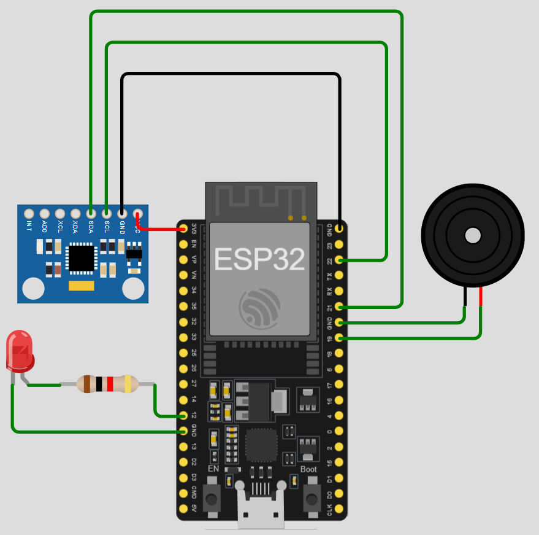
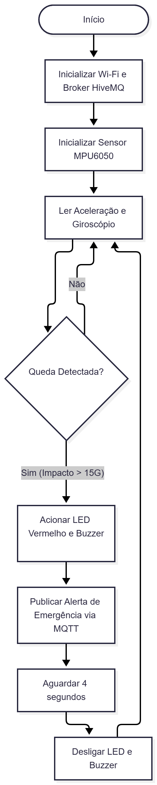

# AuraCare IoT: Acionamento Autônomo de Socorro via Detecção de Movimento

## Sobre o Projeto
O **AuraCare IoT** é um protótipo de dispositivo vestível (*wearable*) desenvolvido para mitigar riscos associados a quedas acidentais em idosos, alinhado ao **ODS 3** (Saúde e Bem-Estar). O sistema monitora continuamente as variações cinemáticas do usuário e, ao detectar um impacto característico de queda, aciona alarmes locais e emite notificações remotas de emergência via internet.

## Hardware Utilizado
* **Microcontrolador:** ESP32 (Dual-core, com Wi-Fi nativo)
* **Sensor (IMU):** Módulo Acelerômetro e Giroscópio MPU6050
* **Atuadores Locais:** 1x LED Vermelho (Sinalizador visual), 1x Buzzer Ativo (Alarme sonoro)

## Interfaces, Protocolos e Comunicação
* **I2C (*Inter-Integrated Circuit*):** Utilizado para a comunicação de dados entre o ESP32 e o sensor MPU6050 (Pinos SDA: 21, SCL: 22).
* **TCP/IP e Wi-Fi:** O ESP32 opera no modo *Station* (`WIFI_STA`) para conectar-se à rede local e acessar a Internet.
* **MQTT (*Message Queuing Telemetry Transport*):** Protocolo de mensageria leve utilizado para comunicação remota. O dispositivo atua como *Publisher*, conectando-se ao broker público **HiveMQ** (`broker.hivemq.com`) na porta 1883 para publicar o payload de emergência.

## Diagramas do Projeto

**Esquema de Montagem Eletrônica:**

**Fluxograma do Algoritmo:**

## Como Reproduzir o Projeto (Instruções de Uso)
O projeto foi validado utilizando a plataforma de prototipagem e simulação. Para reproduzi-lo:
1. Monte o circuito conectando o MPU6050 aos pinos I2C, o LED ao pino 12 (com resistor) e o Buzzer ao pino 19 do ESP32.
2. Na ferramenta de desenvolvimento (Arduino IDE ou Wokwi), instale as bibliotecas obrigatórias:
   * `PubSubClient` (Para a comunicação MQTT)
   * `Adafruit MPU6050` e `Adafruit Unified Sensor` (Para o acelerômetro)
3. Carregue o código-fonte disponibilizado neste repositório.
4. Com o sistema conectado à rede e ao Broker, aplique um movimento brusco no sensor. O algoritmo matematicamente identificará a força G (impacto > 15G), acenderá o LED, emitirá som e enviará o alerta remotamente.

## Software e Código-Fonte
O código-fonte completo e comentado que gerencia a leitura inercial, a conexão Wi-Fi e a publicação no broker encontra-se no arquivo `.ino` na raiz deste repositório. A lógica principal atua com laços de repetição que evitam falsos positivos, atrelando a detecção de queda à variação simultânea do giroscópio e do acelerômetro.

---
*Projeto desenvolvido por Murillo Henrique Santos para a disciplina de Objeton Inteligentes Conectados.*
